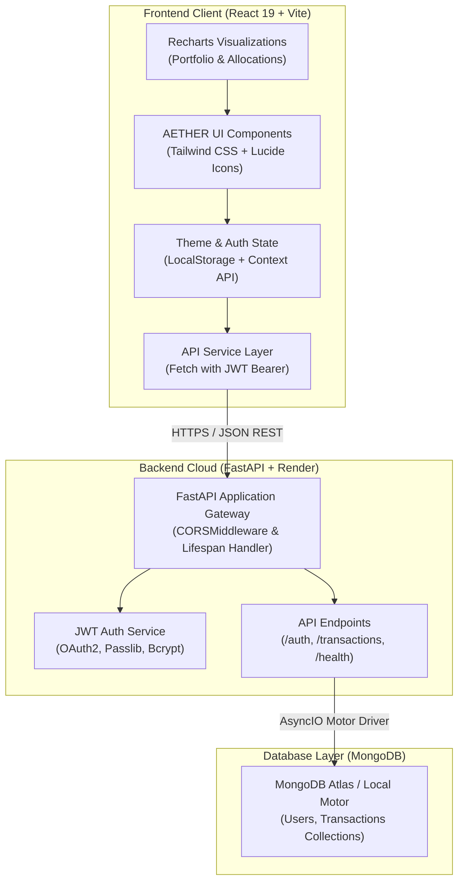

# ⚡ AETHER — Next-Gen FinTech & Quant Investment Terminal

[](https://github.com/Adithya-83/Fintech/actions/workflows/main.yml)
[](https://fastapi.tiangolo.com)
[](https://www.python.org/)
[](https://react.dev/)
[](https://vitejs.dev/)
[](https://www.mongodb.com/)
[](https://tailwindcss.com/)
[](LICENSE)

**AETHER** is a high-performance, real-time quantitative investment dashboard and portfolio management terminal. Built with a sleek dark neon/glassmorphism aesthetic, AETHER pairs a modern **React 19** frontend with an asynchronous **FastAPI + MongoDB (Motor)** backend to deliver institutional-grade trading telemetry, interactive portfolio analytics, and low-latency order execution.

---

## 🔗 Live Deployments & Links

| Service | Link | Description |
| :--- | :--- | :--- |
| 🚀 **Live Backend API** | [fintech-backend-665x.onrender.com](https://fintech-backend-665x.onrender.com) | Production FastAPI instance hosted on Render |
| 📖 **Interactive API Docs (Swagger UI)** | [fintech-backend-665x.onrender.com/docs](https://fintech-backend-665x.onrender.com/docs) | Interactive OpenAPI specifications & sandbox |
| 🩺 **Backend Health & Diagnostics** | [fintech-backend-665x.onrender.com/api/health](https://fintech-backend-665x.onrender.com/api/health) | Real-time database connectivity monitor |
| 📦 **GitHub Repository** | [github.com/Adithya-83/Fintech](https://github.com/Adithya-83/Fintech) | Full source code & CI/CD workflows |

---

## ✨ Key Features

- **📊 Real-Time Portfolio Telemetry**: Instant overview of Total Portfolio Value, Daily P&L, Sharpe Ratio (2.84), Win Rate (68.4%), and risk exposure.
- **📈 Interactive Performance Visualizations**: Dynamic asset performance area charts built with **Recharts**, featuring customizable intervals (`1D`, `1W`, `1M`, `1Y`, `ALL`) and responsive tooltips.
- **🥧 Visual Asset Allocation Breakdown**: Donut breakdown of Equities, Crypto, Fixed Income, and Commodities with percentage weightings and target balance indicators.
- **⚡ Quick Trade Execution Terminal**: Real-time modal for executing simulated Buy & Sell market or limit orders with auto-calculated trading fees and instant balance updates.
- **📜 Live Transaction Ledger**: Filterable, searchable, and paginated transaction history synchronized directly with MongoDB.
- **🔐 Secure JWT Authentication**: End-to-end authentication workflow including user registration, login, bcrypt password hashing, and Bearer token persistence.
- **🌓 Dual Theme Architecture**: Cyberpunk dark mode with ambient neon glowing spheres alongside a clean light mode option.
- **🤖 Automated CI/CD Workflow**: GitHub Actions pipeline automating Python bytecode verification, pytest test suites, and Vite production builds.

---

## 🛠️ Tech Stack & Architecture



### Frontend
- **Framework**: [React 19](https://react.dev/)
- **Build Tool**: [Vite 8](https://vitejs.dev/) with Hot Module Replacement (HMR)
- **Styling**: [Tailwind CSS](https://tailwindcss.com/) & [PostCSS](https://postcss.org/)
- **Charts & Data Viz**: [Recharts](https://recharts.org/)
- **Icons**: [Lucide React](https://lucide.dev/)
- **Linter**: [Oxlint](https://oxc.rs/)

### Backend
- **Framework**: [FastAPI](https://fastapi.tiangolo.com/) (Python 3.11+)
- **Server**: [Uvicorn](https://www.uvicorn.org/) ASGI server
- **Database Driver**: [Motor](https://motor.readthedocs.io/) (Asynchronous Python driver for MongoDB)
- **Authentication**: JWT tokens ([PyJWT](https://pyjwt.readthedocs.io/)) with [Passlib](https://passlib.readthedocs.io/) & [Bcrypt](https://pypi.org/project/bcrypt/)
- **Data Validation**: [Pydantic v2](https://docs.pydantic.dev/)
- **Testing**: [Pytest](https://docs.pytest.org/) & [HTTPX](https://www.python-httpx.org/)

---

## 📡 API Endpoints Reference

| Method | Endpoint | Access | Description |
| :--- | :--- | :--- | :--- |
| `GET` | `/` or `/api/health` | Public | Server status and MongoDB database health check |
| `POST` | `/api/signup` | Public | Register new user account with hashed password |
| `POST` | `/api/login` | Public | Authenticate user and receive JWT Bearer token |
| `GET` | `/api/me` | Protected | Fetch current logged-in user profile & balances |
| `GET` | `/api/transactions` | Protected | Fetch user transaction history (supports pagination) |
| `POST` | `/api/transactions` | Protected | Record a new order execution (Buy/Sell) |
| `GET` | `/api/transactions/summary` | Protected | Quantitative portfolio metrics & allocations |

---

## 🚀 Getting Started

### Prerequisites
- **Node.js**: v18.0.0 or higher (v20+ recommended)
- **Python**: v3.11 or higher
- **MongoDB**: Local MongoDB instance (`localhost:27017`) or MongoDB Atlas URI

---

### 1. Clone the Repository

```bash
git clone https://github.com/Adithya-83/Fintech.git
cd Fintech
```

---

### 2. Backend Setup

1. Navigate to the backend directory:
   ```bash
   cd backend
   ```

2. Create and activate a Python virtual environment:
   ```bash
   # Windows (PowerShell)
   python -m venv venv
   .\venv\Scripts\Activate.ps1

   # macOS / Linux
   python3 -m venv venv
   source venv/bin/activate
   ```

3. Install backend dependencies:
   ```bash
   pip install -r requirements.txt
   ```

4. Configure environment variables:
   ```bash
   cp .env.example .env
   ```
   *Edit `.env` with your MongoDB connection string and JWT secret:*
   ```env
   MONGODB_URL=mongodb://localhost:27017
   DATABASE_NAME=fintech_db
   JWT_SECRET=your_jwt_secret_key_here
   BACKEND_PORT=8000
   FRONTEND_ORIGIN=http://localhost:5173
   ```

5. Run the FastAPI development server:
   ```bash
   python main.py
   # Or using uvicorn directly:
   uvicorn main:app --reload --port 8000
   ```
   *The API will be available at `http://localhost:8000` (Swagger docs at `/docs`).*

---

### 3. Frontend Setup

1. Open a new terminal and navigate to the project root:
   ```bash
   cd fintech-dashboard
   ```

2. Install Node dependencies:
   ```bash
   npm install
   ```

3. (Optional) Configure environment variable for custom API URL:
   Create a `.env` file in the root directory:
   ```env
   VITE_API_URL=http://localhost:8000
   ```
   *(Defaults to `https://fintech-backend-665x.onrender.com` if omitted)*

4. Launch the Vite development server:
   ```bash
   npm run dev
   ```
   *The application will open at `http://localhost:5173`.*

---

## 🧪 Running Tests & Quality Checks

### Run Backend Pytest Suite
```bash
pytest backend/tests -v
```

### Run Frontend Linting & Build Verification
```bash
# Check lint rules
npm run lint

# Compile production bundle
npm run build
```

---

## 📄 License

This project is licensed under the [MIT License](LICENSE).
